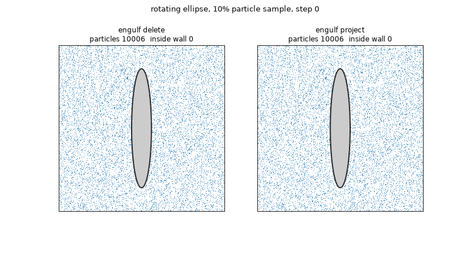
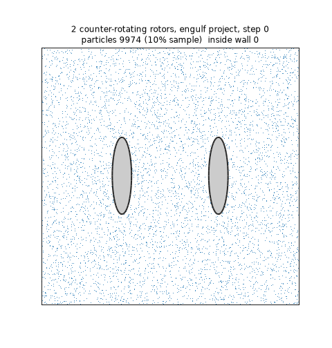
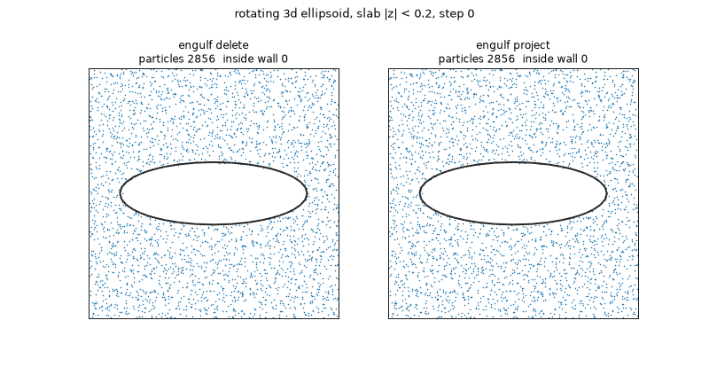
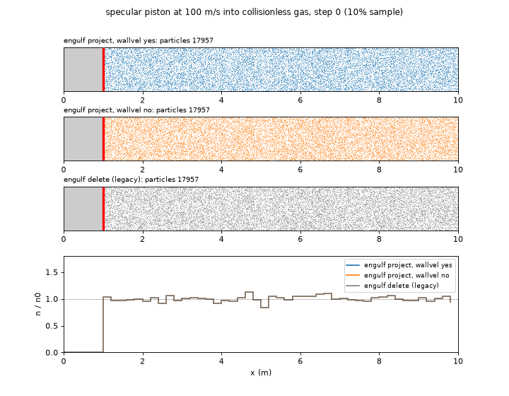
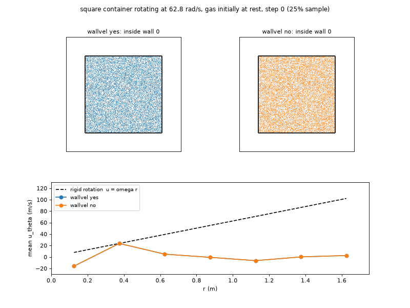
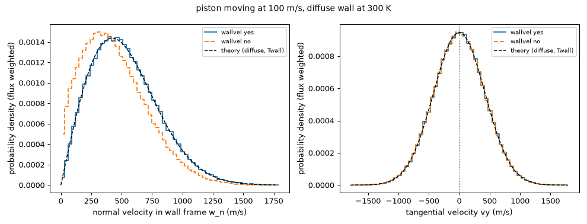
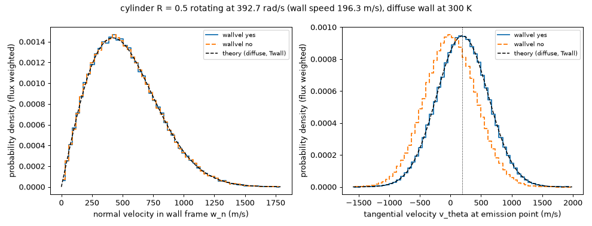

# moving_wall_validation — 移動壁の回帰テスト

`fix move/surf` / `move_surf` に追加した2つの機能を検証する回帰テストです。

| キーワード | 値 | 内容 |
|---|---|---|
| `engulf` | `delete`（既定）/ `project` | `delete` = 従来どおり、移動要素を含むセルの全粒子を削除。`project` = 壁内に入った粒子だけを最寄りの壁面の外側へ退避（他ランクのセルへは粒子移送）、救済できない粒子のみ計上して削除 |
| `wallvel` | `yes` / `no` | `yes` = 移動表面とのすべての衝突（通常の粒子移動中と退避時）を壁静止系で行う：`w = v − u_w` → 既存の `collide()` → `v' = w' + u_w`。壁速度は ω = θ/(Nlarge·dt)、並進速度 = Δ/(Nlarge·dt) で、run の1ステップ目から有効。既定は `engulf project` なら `yes`、`delete` なら `no`。`yes` は `engulf project` が必須 |

入力例：

```
fix 10 move/surf rotor 1 2000 rotate 360 0 0 1 5 5 0 engulf project
```

## 検証結果（アニメーション）

各フレームの見出しの「inside wall」は、壁の内側（固体側）に残った粒子の数です。該当する粒子は赤で描きます。5本の GIF すべてで、全フレーム 0 です。数値は GCC + OpenMPI、4 プロセスでの結果です。

### 1. 回転する楕円（2D）：質量保存



左が従来の `engulf delete`、右が今回の `engulf project` です。従来方式は、壁が動くたびに壁を含むセルの粒子を丸ごと消すため、回転する壁が粒子を吸い込むように気体が薄くなっていきます（10% サンプルで 10006 → 838 個、全粒子では 1000 ステップで 100000 → 8197 個）。今回の方式は、壁内に入った粒子だけを壁の外へ戻すので、粒子数は最後まで変わりません。

### 2. 逆回転する2本のロータ：ルーツポンプ型の配置



2本のロータを、それぞれ別の `fix move/surf` で逆向きに回しています。ロータ同士が近づく領域でも粒子が壁内に残らず、全体の粒子数（100000 個）も保たれます。サブドメイン境界をまたいで退避した粒子は、削除せずに隣のプロセスへ送ります。

### 3. 回転する楕円体（3D）：三角形要素でも同じ結果



中央の層（|z| < 0.2）の粒子と、z = 0 での断面です。左が `delete`、右が `project` です。3D の三角形要素でも、従来方式は層の粒子が 360 個まで減り、今回の方式は 2877 個前後を保ちます（全粒子 32000 個は不変）。

### 4. 進入するピストン：法線方向の運動量伝達（p-dV 仕事）



鏡面反射のピストンが 100 m/s で、静止した無衝突気体に進入します。上3段は粒子、下段は密度分布 n/n₀ です。

- **`wallvel yes`（今回）**：壁の速度が反射に入るので、ピストン前方に圧縮領域ができます。平均面圧は p/p₀ = 1.4373 で、自由分子流の解析解 1.4377 と 0.03% 以内で一致しました。
- **`wallvel no`**：粒子は保存されますが、壁が気体を押す分の運動量が伝わりません。面圧は 1.189（−17%）で、壁際に粒子が溜まります。
- **`delete`（従来）**：ピストン前方の気体が削除されて密度が下がり、面圧は 0.117 まで落ちます。

### 5. 回転する正方形容器：接線方向を含む全衝突での運動量伝達



静止した気体を入れた正方形容器を 62.8 rad/s で回転させます（拡散反射、壁温＝気体温度）。下段は、半径 r ごとの平均周方向速度 u_θ です。

- **`wallvel yes`**：気体は理論上の平衡状態である剛体回転 u_θ = ωr に到達します（回転率の比 0.9996）。
- **`wallvel no`**：剛体回転の約 10% しか回りません。

正方形の各辺は回転とともに気体を法線方向にも押すので、この試験は質量保存・法線成分・接線成分を一度に確かめる受け入れ試験になっています。

### 6. 拡散反射の速度分布：壁静止系での反射を分布の形で確認

上の5つはマクロな量での検証です。ここでは、移動壁で拡散反射した直後の粒子の速度分布そのものを、散乱核の理論分布と比べます。気体分子どうしの衝突は切り（`collide` なし）、壁と粒子の相互作用だけを測ります。

- **並進**（`in.test_translation`、3D）：+x へ 100 m/s で進むピストンに、冷たいビーム（1000 m/s、30 K）を正面から当てます。
- **回転**（`in.test_rotation`、2D）：392.7 rad/s で回る内筒（R = 0.5、壁速度 Rω = 196.3 m/s）に、外筒から中心向きのビームを当てます。外筒は吸収面です。

入射粒子はすべて壁に向かうので、壁の近くで「壁静止系で離れていく粒子」は反射粒子だけです。壁を吸収面にした対照実行で、この判定に紛れ込む粒子が 0 個であることも確認しています。

壁から 0.05 の層の中の粒子は、密度で重み付けされた分布になります（遅い粒子ほど長く層にとどまるため）。そこで、各粒子を層内の滞在時間の逆数で重み付けし、壁から出ていく流束で重み付けした分布、つまり拡散反射の散乱核そのものに換算して比べます。円筒では、粒子が外へ進むと周方向速度が角運動量保存で R/r 倍に下がるため、直線軌道を円周上の放出点までさかのぼり、その点で成分を求めます。

理論（壁温 300 K、c = √(2kT/m) = 596.9 m/s）：

- 法線成分（壁静止系）：(2w/c²)·exp(−w²/c²)
- 接線成分：壁速度を中心とするガウス分布（標準偏差 c/√2）





| 量 | 並進（`wallvel yes`） | 回転（`wallvel yes`） | 理論 | `wallvel no` |
|---|---|---|---|---|
| 法線成分の平均 | 530.5 m/s | 528.1 m/s | 529.0 | 並進で 445.3（壁が気体を押す分が欠ける） |
| 接線成分の平均 | 1.3 m/s | 196.4 m/s | 0 / 196.3 | 回転で 0.5（壁と一緒に回らない） |
| 接線成分の標準偏差 | 421.8 m/s | 421.6 m/s | 422.1 | 一致（温度は正しい） |

`wallvel yes` は、全項目が「標準誤差の4倍＋c の 1%」以内で理論と一致しました。`wallvel no` は、壁速度が関わる成分だけが外れます。

### 7. エネルギー収支：壁との仕事と熱を分ける

`compute surf` は、壁との衝突ごとに実験室系の入射前と反射後の速度で、運動量（`fx`、`tz`）とエネルギー（`etot`）を集計します。壁速度を u_w とすると、気体から壁への量は次のように分けられます。

- 仕事 W = u_w·F（並進）、ω·T（回転。T は `com` まわりのトルク）
- 熱 Q = E − W（壁静止系で気体が失ったエネルギー）

**ミクロ（`in.micro_energy`、`verify_micro_energy.py`、`run_all.sh` に含む）**：6 節の並進ピストンと同じ設定（冷たいビーム、気体衝突なし）で、衝突 1 回あたりの Fx・W・Q・E を拡散反射の散乱核から求めた理論値と比べます。理論は、入射ビームの流束重み付きの平均と、壁静止系の出射の平均（法線 √π c/2、運動エネルギー 2kT_w）から求めます。退避した粒子の遅れた反射も集計に含まれます。

| 衝突 1 回あたり（単位 m×10⁴ m²/s²、Fx は m×m/s） | `wallvel yes` | 理論 | `wallvel no` |
|---|---|---|---|
| 運動量 Fx | −1645.9 | −1645.2 | −1545.9 |
| 仕事 W = U·Fx | −16.46 | −16.45 | −15.46 |
| 熱 Q = E − W | 29.39 | 29.32 | 34.18 |
| 実験室系エネルギー E | 12.93 | 12.87 | 18.72 |

`wallvel yes` は 4 項目とも「標準誤差の4倍＋0.1%」以内で一致しました。`wallvel no` は、出射が実験室系で静止壁の分布になるので、衝突 1 回あたりの運動量が壁速度の分（m×100 m/s）だけ小さくなります。

**マクロ（`in.macro_heating`、`verify_macro_heating.py`、`run_macro_heating.sh` で別に実行）**：5 節の回転容器に気体衝突（VSS、Kn ≈ 0.2）を入れ、気体 100 K・壁 300 K から 50000 ステップ（50 回転）回します。判定は次のとおりです。

- 第一法則：気体の運動エネルギーの変化と、壁へのエネルギー流 E の時間積分が、20 ステップごとに丸め誤差（10⁻¹⁴）で一致すること
- 温度：後半の平均が 300 K、後半の傾きが 0（数値加熱による上昇がない）
- 定常の W と Q の平均が 0、剛体回転に到達

閉じた系の定常状態では、どんな方式でも E = W + Q は平均 0 になります。W = 0 まで成り立つのは、気体に壁以外からトルク（人工的な摩擦）がかからない場合だけです。DSMC の衝突は、ペアの位置が離れているぶん角運動量を厳密には保存しないので、剛体回転では抵抗として働きます。乱数で選ぶ既定のペアでは W ≈ −0.019 W、`collide_modify nearcp yes` では −0.006 W でした。この試験の既定は `nearcp yes` です。気体衝突なしで測った、退避による角運動量の誤差は −1.7×10⁻⁵ N m で、統計的に 0 と区別できませんでした（DSMC の分の 6% 以下）。

**凍結した壁の手前での停止（2026-10-19 修正）**：当初、`wallvel yes` は 1〜2 万ステップで「Collision cell volume is zero」により停止していました。後退する壁で壁静止系の反射をすると、実験室系の速度が凍結した壁の裏を向くことがあります（v'·n < 0）。素通り（後退壁の古い位置）では必ずそうなります。そのまま進んだ粒子は固体側に入り、ステップ末の退避までの間の気体衝突で、固体側のセル（体積 0）に 2 個以上いると停止していました（8000 ステップで 61 件、うち 57 件が反射、4 件が素通り）。現在は `Update::move()` が、そのような粒子をそのステップの残りの間、衝突点（気体側へセル寸法×10⁻⁶ ずらした位置）に止めます。速度は変えないのでエネルギーと集計は変わらず、壁が後退すれば気体側に残ります。修正後は固体側のセルに入る粒子が 0 件になり、50000 ステップを最後まで実行して 9 項目すべてに合格しました（剛体回転の比 1.0007、後半の温度 300.10 K、傾き +0.23 K、定常の W −0.005 W・Q +0.005 W）。`nearcp no` でも 4・8 プロセスで最後まで実行できます。止めた粒子の数は run の終わりに `Wall-frame stops` として表示され、この試験では 1 ステップあたり約 9.5 件（壁との衝突の約 0.8%）です。

## 実行方法

```
./run_all.sh [SPARTA実行ファイル] [プロセス数]
# 既定: ../../src/spa_mpi, 4 プロセス
# 起動コマンドは環境変数 MPIRUN で変更可（既定: mpirun --oversubscribe -np N）
```

出力はすべて `out/` に書かれ（git 管理外）、最後に `check.py`、`verify_distribution.py`、`verify_micro_energy.py` が各項目を `PASS` / `FAIL` で判定します。1つでも `FAIL` があるか、実行が異常終了すると終了コード 1 を返します。所要時間は 4 プロセスで約 1 分です。速度分布の判定（`verify_distribution.py`）は純 Python で動き、`.venv` に matplotlib があれば図も `out/` に出力します。

長時間のエネルギー収支（7 節のマクロ）は別に実行します（2 ケース、4 プロセスで約 1 分、出力は `out_macro/`、図は `out_macro/macro_heating.png`）。

```
./run_macro_heating.sh [SPARTA実行ファイル] [プロセス数] [ステップ数]
```

## 試験一覧

| 入力 | 検証内容 | 合格条件 | 実測（GCC + OpenMPI, 4 プロセス） |
|---|---|---|---|
| `in.ellipse2d` | 閉じた箱の中で回転する楕円（2D）。`delete` と `project` を比較 | `project`：粒子数が不変、どの時刻でも壁内の粒子 0 個。`delete`：未改造 SPARTA と統計出力が一致（`ref/`、4 プロセス時のみ） | 100000 → 100000、壁内 0。`delete` は 100000 → 8197 で参照と完全一致 |
| `in.ellipsoid3d` | 回転する楕円体（3D、三角形要素） | 粒子数が不変、壁内 0 個 | 32000 → 32000、壁内 0（`delete` は → 4815） |
| `in.two_rotors` | 逆回転する2本の楕円（ルーツ型、fix 2本） | 粒子数が不変、両ロータの内部 0 個 | 100000 → 100000、内部 0 |
| `in.move_surf_cmd` | `move_surf` コマンドによる瞬間移動（セル4個分の平行移動） | 削除 0、移動後の内部 0 個 | 退避 6688、削除 0（`delete` は 8596 個削除） |
| `in.piston` | 鏡面反射のピストンが U = 100 m/s で無衝突気体に進入（`-var dx -0.8` で後退）。法線方向の運動量伝達を検証 | 静止壁の較正 p/p₀ = 1 ± 3%。`wallvel yes` の面圧が自由分子流の解析解 p/p₀ = (1+2s²)(1+erf s) + (2s/√π)e^(−s²), s = U/c_mp の ±3% 以内 | 較正 1.0039、`wallvel yes` 1.4373（解析解 1.4377、差 −0.03%）、後退 0.6791（解析解 0.6745、+0.68%）。参考：`wallvel no` 1.1887、`delete` 0.1166 |
| `in.piston`（初動） | `nevery 20` で最初の 40 ステップだけを平均。最初の表面移動より前から壁速度が正しく入るかを検証 | 解析解の ±3% 以内 | 1.4386（+0.06%）。壁速度を初回移動時に測っていた旧版では 1.3448（−6.5%） |
| `in.rotating_box` | 静止した気体を入れた正方形容器が ω = 62.83 rad/s で回転（拡散反射、壁温＝気体温度）。接線方向を含む全衝突での運動量伝達を検証 | 粒子数が不変。平衡解である剛体回転 u_θ = ωr に対し、気体の回転率（r < 1.75 のセルで最小二乗）が ω の ±3% 以内 | 回転率 62.81 1/s（比 0.9996）。参考：`wallvel no` では比 0.0975 |
| `in.test_translation` / `in.test_rotation` | 移動壁で拡散反射した粒子の速度分布（気体衝突なし）。`-var model diffuse\|vanish -var wallvel yes\|no` | `verify_distribution.py`：`wallvel yes` の法線・接線成分の平均と標準偏差が理論値と「標準誤差の4倍＋c の 1%」以内で一致。吸収壁の対照で、反射粒子と誤認される粒子が 0.1% 以下 | 14 項目すべて合格（詳細は「6. 拡散反射の速度分布」） |
| `in.micro_energy` | 移動ピストンとの衝突 1 回あたりの運動量・仕事・熱（気体衝突なし）。`-var wallvel yes\|no` | `verify_micro_energy.py`：Fx・W・Q・E が散乱核の理論値と「標準誤差の4倍＋0.1%」以内、削除 0 | 5 項目すべて合格（7 節） |
| `in.macro_heating`（`run_macro_heating.sh`） | 回転容器、気体衝突あり、100 K から 50000 ステップ。`-var wallvel yes\|no [-var nrun N] [-var nearcp yes\|no]` | `verify_macro_heating.py`：第一法則（10⁻⁶）、温度の平均と傾き、定常の W・Q、剛体回転 | 9 項目すべて合格（7 節） |
| `in.amr_static` | 細分化した格子（AMR）で回転楕円。`-var amr none\|surf\|region`：一様格子（対照）、初期の壁付近だけ 3 段細分化（回転する壁が細かいセルと粗いセルの境界を横切る）、掃過円内を 2 段細分化 | 粒子数が不変、削除 0、`fix grid/check 1 silent outside yes`（粒子が割り当てセル・サブセル内にあり、壁の内側にない）の累積件数 0、ダンプで壁内 0 個 | 3 ケースとも合格（400 / 1108 / 3112 セル、最大レベル 1 / 4 / 3） |
| `in.amr_dynamic` | 実行中に格子を変える：`fix adapt`（`-var adapt surf\|particle`）＋ `fix balance` | 同上 | `surf` は壁を追って 400 → 2638 セル、`particle` は 400 → 約 1540 セル。いずれも合格 |
| `in.amr_3d` | 3D 楕円体、粗い 10³ 格子＋初期の壁付近を 2 段細分化（4304 セル） | 同上 | 合格 |
| `in.guard_rotate` / `in.guard_cll_translate` / `in.guard_piston` | 誤った組み合わせの拒否：`wallvel yes` の表面に、自分で壁速度を加える反射モデル（`diffuse` の `rotate`、`cll` の `translate`、`piston`）を割り当てる | `error->all()` で停止し、所定のエラーメッセージが出ること。`wallvel no` との併用は従来どおり動くこと | 3件とも停止、`wallvel no` は実行可 |

`INFO` 行は比較用の参考値で、合否には使いません。従来方式や `wallvel no` では検証量が大きく外れることを示しています。

## 注意点

- **参照データ**：`ref/ellipse2d_delete.np4.stats` は、未改造 SPARTA（commit 62cc4756）を GCC + OpenMPI で 4 プロセス実行して作ったものです。プロセス数が異なると比較は `SKIP`、別のコンパイラや MPI で浮動小数点の差が出た場合は `WARN` になります。
- **`data.square`**：辺を格子線（セル幅 0.25）から外すため、一辺を 3.9 にしています。面がセルの面とちょうど重なると、SPARTA 本体の `Grid::set_inout()` が「Cell type mis-match」で停止します（従来の `engulf delete` でも同じです）。
- **壁速度の初期化**：`fix move/surf` が `Nlarge` を渡し、run ごとの `init()` でその時点の timestep から壁速度を計算します。表面の移動のたびにも同じ式で再計算するので、run の途中で timestep が変わっても追従します。
- **反射モデルの組み合わせ**：`wallvel yes` の表面に `surf_collide piston`、または `translate` / `rotate` キーワード付きの `diffuse` / `cll` を割り当てると、run 開始時にエラーで停止します（壁速度の二重加算を防ぐため。判定は `SurfCollide::has_added_velocity()`）。
- **凍結した壁の手前での停止**：`wallvel yes` では、後退する壁との衝突（または素通り）のあと実験室系の速度が凍結した壁の裏を向く粒子を、そのステップの残りの間は衝突点に止めます（7 節）。粒子の位置が最大 1 ステップ分遅れる近似で、件数は run の終わりの `Wall-frame stops` に出ます。後退するピストンの面圧は修正前と同じ 0.6791（解析解 0.6745）でした。
- **未対応**：Kokkos と implicit surf では `engulf project` をエラーにしています。
- **詳細な計数**：`src/move_surf.cpp` を `-DDEBUG_SPARTA_ENGULF=1 -DDEBUG_SPARTA_WALLFRAME=1` 付きでコンパイルすると、ステップごとに壁内粒子・退避・壁静止系での反射の件数と、ω・最大移動量が表示されます。

## GIF アニメーション

```
./generate_all_gifs.sh [SPARTA実行ファイル] [プロセス数]
```

入力を `-var anim N`（N ステップごとに粒子のサンプルと壁形状を dump）で実行し、`make_gifs.py` が `gifs/` に GIF を書き出します。作業ファイルは `anim_out/`（git 管理外）に置かれ、所要時間は 4 プロセスで約 1 分です。速度分布の判定（`verify_distribution.py`）は純 Python で動き、`.venv` に matplotlib があれば図も `out/` に出力します。`-var anim` を付けない通常実行では dump は出力されず、回帰テストの結果は変わりません。

Python には numpy・matplotlib・Pillow が必要です。`PYTHON` 環境変数、`./.venv/bin/python`、`python3` の順に探し、無ければ次の導入手順を表示して停止します。

```
python3 -m venv .venv && .venv/bin/pip install matplotlib pillow
```

生成される GIF とその見どころは、冒頭の「[検証結果（アニメーション）](#検証結果アニメーション)」を参照してください。

壁の内側（固体側）にある粒子は赤で大きく描き、各フレームの見出しに件数（inside wall）を表示します。固体側の判定は、2D では法線の向き（SPARTA の法線 = ẑ×(v2−v1) が気体側）を考慮した巻き数、3D では凸多面体の面判定で行います。dump は全精度（%20.15g）で出力するので、壁から 10⁻⁶ セル幅だけ離して置いた粒子が丸めで内側と判定されることはありません。現在の結果では、全 GIF の全フレームで 0 件です。
